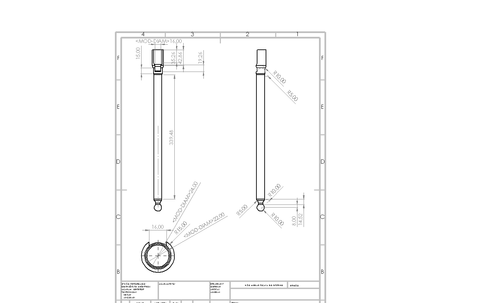

# 🦾 Trabalho Final — Metodologia (Atuador Mecânico)

Trabalho final da disciplina de **Metodologia de Projeto**: desenvolvimento de um sistema
mecânico de braços e alavancas, inspirado num atuador do tipo manopla aceleradora, com garra
(agarrador) e pinça.

Projeto completo — modelagem 3D, montagem, desenhos técnicos e memorial descritivo.

## 📐 Conjunto

| Arquivo | Descrição |
|---|---|
| `Montagem_Final.SLDASM` | Montagem final do sistema |
| `Mont Bucha.SLDASM` | Sub-montagem da bucha |
| `Extrutura braço.SLDPRT` | Estrutura do braço |
| `Braco_Superior.SLDPRT` | Braço superior |
| `Braco_Inferior.SLDPRT` | Braço inferior |
| `Peca_Manopla_Aceleradora.SLDPRT` | Manopla/atuador |
| `Agarrador.SLDPRT` | Garra |
| `Pinça.SLDPRT` | Pinça |
| `Orelha_Suporte.SLDPRT` | Orelha de suporte |
| `HandleZinho.SLDPRT` | Handle/manete |

## 📝 Documentação

- `Desenhos/` — desenhos técnicos das peças (`.SLDDRW` + `.JPG`)
  -  — exemplo: braço superior
- `documento/` — memorial descritivo do projeto (`.docx`)

## 🖨️ Como usar

Abra os arquivos `.SLDPRT`/`.SLDASM` no SolidWorks (versão usada: 2017 SP3). Os desenhos em
`.JPG` podem ser vistos direto aqui, e os `.SLDDRW` são editáveis.

## 📄 Licença

[CC BY-NC-SA 4.0](LICENSE) — trabalho acadêmico; use e adapte dando o crédito, sem fins comerciais.
